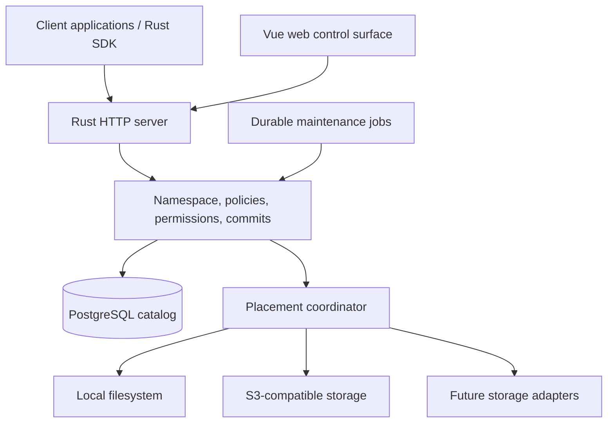

# ScT — Stipa ca Truova

Architecture and implementation plan.

The project is branded **ScT**, expanded as **Stipa ca Truova**. Use `sct` for the repository, directory, domain label, and code identifiers; Rust crates use the `sct-` prefix.

Status: M1 foundation (SCT-6–13) is implemented. Payload storage functionality and M2–M5 remain pending. See `docs/foundation.md` for implemented behavior and `contracts/README.md` for wire conventions.

Date: 2026-09-14. Backend abstraction revised: 2026-09-15.

This document records the product decisions agreed during architecture planning and expands them into implementation contracts, milestones, and acceptance criteria. Technical defaults below are proposed implementation choices where the product discussion did not prescribe a particular mechanism. They must be changed explicitly in this document if implementation evidence warrants a different choice.

## 1. Product contract

ScT is a self-hosted storage service. Clients store data in a logical directory tree, choose version-retention policies, and later list and download their content. The server enforces namespace, retention, integrity, and placement rules; clients decide what the content means. Underlying durability and consistency follow the selected adapters' documented behavior, which administrators evaluate when configuring roots.

The first delivery consists of:

- A Rust server with a versioned HTTP API.
- A proper web control surface.
- An independently consumable Rust client library.
- Extensible storage backends, initially local-filesystem and S3-compatible adapters, with synchronous mirrored placement.
- Independent file versions and atomic directory versions.
- Strict and relaxed retention, quotas, resumable uploads, chunk reuse, and integrity maintenance.

Clients own backup scheduling, producing consistent source files, and recovering their applications. There is no application restoration action in ScT. A consumer reads its old files and decides what to do with them.

Personal content organization, Android apps, OCR, embeddings, visual similarity, synchronization between devices, remote service control, and integrations into existing services are outside this delivery. A future personal-storage product may use this API while maintaining its own domain model.

### 1.1 Decisions from the product discussion

| Area | Decision |
|---|---|
| Audience | A private shared installation for users and service clients |
| Trust | The server may read stored content; end-to-end encryption is not required |
| Scale | Tens of TB and millions of files, including large database snapshots |
| Namespace | Directories and files, with optional retained history |
| Versioning | Independent file history or atomic directory history |
| Strict retention | Preserve the configured rolling history; fail writes when capacity cannot satisfy it |
| Relaxed retention | Older history is reclaimable; the latest content version survives |
| Deletion | Hide entries and retain their history; permanent purge is separately authorized |
| Placement | Per-user storage roots select configured backend instances through a provider-independent placement model |
| Mirrored success | Both permanent replicas must acknowledge each required object before publishing a version; an offline required destination blocks publication |
| Backend trust | ScT trusts adapter outcomes; administrators select adapters according to their documented guarantees |
| Read selection | Explicit destination order and timeouts per root; speed and availability are optional instance hints, not an automatic scoring system |
| Isolation | Roots independently bound placement, quotas, reclamation, and atomic snapshots |
| Capacity allocation | Administrators allocate pool capacity to user storage roots and a separate server-managed staging allocation shared by users |
| Mutation coordination | One durable mutation owner per root, held across backend I/O; reads remain available with content pins |
| Configuration | Administrators configure backend instances, provider settings, and private credential references |
| Client policies | Clients may configure retention within their authorized roots |
| Scheduling | Clients schedule uploads; the server can display expected frequency and overdue state |
| Recovery | Consumers list and download their own data; no recovery orchestration |

## 2. Architecture and deployment

Use one active Rust service process initially, PostgreSQL for authoritative metadata, and immutable objects in the configured payload backends. This targets large archives without introducing distributed server coordination in the first release.

### 2.1 Component boundaries

| Component | Responsibilities |
|---|---|
| Protocol crate | Public DTOs, identifiers, errors, manifest contracts, protocol versions |
| Client crate | HTTP transport, chunking, transfer negotiation, retries, progress, verified downloads |
| Core crate | Authorization, namespace operations, retention, quota admission, commit state machines, persistence and storage adapters |
| Server crate | HTTP routing, authentication integration, configuration, runtime wiring, maintenance workers, administrative commands |
| Web application | Directory and version browsing, policies, transfers, capacity, credentials, administration |

Use Tokio and Axum for the server, SQLx with PostgreSQL, and Vue 3 with TypeScript for the web application. Generate OpenAPI and web contract types from Rust-owned definitions. Do not maintain independent handwritten wire models in each component.

The client crate must not depend on the server or require a checkout of Crumbles, Simple Agents, Pezzottify, or any other consumer. Publish or distribute it independently with its protocol dependency.

HTTP handlers translate requests into application operations. Domain decisions belong in the core and must be reused by web, SDK, and administrative entry points. Backend adapters handle bytes, not namespace permissions or retention policy.

### 2.2 Deployment assumptions

- One active server instance; enforce an exclusive instance lease and refuse a second writer.
- PostgreSQL uses durable commits and versioned, forward-only migrations.
- HTTP traffic uses HTTPS, normally through the existing reverse proxy.
- The server serves the built web application from the same origin.
- Local storage paths are dedicated administrator-configured directories. User paths never become host paths directly.
- Backend credentials come from private configuration or secret references and never reach client applications.
- Encryption at rest is supplied by configured encrypted volumes or backend encryption. The application does not invent a cryptographic storage format in v1.
- Backends must be online-readable. Cold archive classes requiring asynchronous retrieval are outside v1.

## 3. Users, roots, and logical paths

### 3.1 Storage roots

A storage root is an administrator-assigned mount in a user's logical tree. It contains an owner, display name, mount path, storage placement, quota, default policy, access grants, and operational state.

Roots reference configured backend instance IDs, not provider-specific fields. A backend instance combines an adapter kind (initially local or S3), validated provider configuration, private credential references, and a stable destination identity. Placement is either a single instance or, in v1, a synchronous mirror of two distinct configured destinations with an explicit read preference. Provider kinds do not determine which combinations are allowed. Dropbox and other local or network storage systems are future adapter candidates; this abstraction does not imply they are already supported. Administrators choose destinations based on adapter documentation; ScT does not certify their durability or failure-domain independence.

Adapters document their guarantees. Configured instances may include optional expected speed and availability hints (§8.1); two instances of one adapter kind need not behave alike. Root read policy explicitly defines destination order and timeouts. Hints help administrators choose that policy but do not automatically determine read order.

Example:

| User | Logical root | Placement |
|---|---|---|
| User A | `/databases` | Dedicated local backend directory |
| User A | `/archive` | S3 bucket and dedicated prefix |
| User A | `/critical` | Local backend plus S3 |
| Service B | `/state` | Separate local backend allocation |

Roots cannot overlap. Atomic versions, renames, quota admission, deduplication, and pressure-driven reclamation stay within one root. Cross-root copying is performed by the client through reads and writes.

Placement is fixed once a root contains data. Credential rotation for the same destination is allowed. Moving a populated root to a different destination requires a future migration operation and must not be implemented as a configuration-only pointer change.

### 3.2 Namespace semantics

- Expose directories and regular files, not a mounted POSIX filesystem.
- Use case-sensitive UTF-8 names and `/` as the logical separator. Reject empty components, `.`, `..`, NUL, and path traversal.
- Store stable entry identities independently of names so in-root renames preserve history.
- Preserve each file's entry ID across snapshots within its storage root, including explicit renames. A newly created file at a previously deleted path receives a new ID. Entry identity is distinct from version identity and content digests; identical bytes do not imply identical entries.
- Directory listings are paginated and do not scan payload storage.
- Preserve empty directories in atomic directory manifests.
- Optional client metadata is bounded and opaque to the server. Content types and original timestamps are descriptive, not authority for authorization or retention order.
- Symlinks, device nodes, ownership restoration, ACL restoration, and filesystem execution semantics are not part of the public v1 abstraction. Clients can package such information as ordinary files.

A rename must not silently change effective retention and delete history. Reject renames across differing inherited-policy boundaries unless the request explicitly selects the resulting policy and acknowledges its retention effect. Moves into or out of atomic versioning directories are not ordinary renames.

## 4. Versioning and retention

### 4.1 Independent file history

An independent file has a current version and zero or more retained previous versions. A write publishes one new immutable version after upload and admission succeed.

Retention is inherited from the nearest explicit directory policy, with a file-level override taking precedence. Defaults are strict retention with one version. Keep-one files still use immutable replacement internally; their previous version is retired only after replacement commits.

### 4.2 Atomic directory history

An atomic versioning directory has a history of complete immutable trees. Clients stage a tree or changes against an expected base revision and publish one directory version.

- Readers see the previous tree until the whole new tree commits.
- No individual descendant becomes visible early.
- Unchanged files and subtrees can reuse previous manifests and chunks.
- The directory has one retention policy; descendant histories and overrides are not independently configurable.
- Atomic versioning directories cannot nest or overlap.
- An atomic directory cannot span storage roots.
- Populated directories cannot change versioning mode in v1.

Clients declare whether a draft is a complete replacement tree or a set of explicit changes against a base tree. Omission means deletion only for a complete replacement; patch drafts delete only explicitly named entries. This distinction must be visible in the protocol.

Drafts carry existing entry IDs when preserving or renaming entries; creation obtains a new root-scoped identity. Validate root ownership, uniqueness within the resulting tree, and identity continuity against the base snapshot. A path or digest alone must not imply a rename. Each published snapshot is a complete logical tree with shared immutable nodes and chunks, not a delta chain requiring replay of earlier snapshots. File entry IDs live in tree records independently of reusable file-content manifests.

### 4.3 Retention count

`keep_versions = N` includes the current content version. Three means current plus two previous successful versions. Before enough successful writes exist, fewer versions are available; the server does not manufacture historical versions.

| Mode | Normal state | Under capacity pressure |
|---|---|---|
| Strict | Latest N successful versions | Protected history cannot be reclaimed to admit another write |
| Relaxed | Up to N successful versions | Oldest historical versions may be reclaimed; latest content remains protected |

Retention order uses server commit order. Client timestamps cannot reorder history or cause another version to be evicted.

Strict retention is a capacity and lifecycle policy, not legal WORM storage: separately authorized policy changes and explicit purges can remove history.

### 4.4 Policy changes

Policy mutations use expected policy revisions. The server validates changes against the caller's grants and administrator constraints.

Lowering a version limit or relaxing protection returns a preview of the affected history before an explicit apply operation. Preserve the evaluated policy revision in the apply request and reject stale previews. Increasing a strict count protects available versions immediately but cannot recover already pruned history or reserve unknown future file sizes.

Large inherited-policy changes are processed as durable, resumable jobs. Mark the affected scope as transitioning and retain the root's mutation ownership until the transition completes or recovers. Other mutations in that root wait or receive `root_busy`; reads and unrelated roots remain usable. The UI must expose transition progress and failures. Scope-level concurrent mutation is deferred.

### 4.5 Delete and purge

Ordinary deletion hides the entry and its descendants from the current namespace. It does not free retained content immediately. Deleted entries remain browsable through an explicit deleted-entry listing, and retained versions remain downloadable.

The latest content version remains protected even when its entry is hidden. A tombstone is namespace metadata and does not consume a content-version slot. Deleted data continues to count toward quota until retention or explicit purge releases it.

Permanent purge requires a distinct capability and an explicit target. Do not allow a generic write credential to bypass retention through a delete or policy-management endpoint. Restoring content into a live application remains the consumer's responsibility.

## 5. Content representation and chunk reuse

Use FastCDC v2020 with a fixed initial profile: 256 KiB minimum, 1 MiB target, 4 MiB maximum. Identify chunks with SHA-256 of their raw bytes. Pin the profile and its exact implementation behavior in cross-client fixtures; persist the profile identifier in file manifests.

The rolling fingerprint used for chunk boundaries is not an integrity checksum. Server verification always uses the cryptographic digest and exact length.

### 5.1 Objects and manifests

- A chunk is immutable content, deduplicated within one storage root.
- A file manifest contains ordered chunk identifiers and lengths, the total length, and a format version.
- A file-manifest digest identifies its canonical representation; it must not be presented as the SHA-256 of the reconstructed file bytes.
- A directory manifest records names, entry kinds, metadata, and child-manifest references.
- Large file chunk lists and large directories use bounded manifest pages. Reuse unchanged immutable pages and directory subtrees.
- Each file or directory version describes complete content, independently of whether earlier versions are retained.

Use a versioned canonical serialization with deterministic ordering and shared test vectors. Select canonical JSON for v1, with integer sizes and UTF-8 names; reject noncanonical or out-of-range representations at manifest ingestion. Metadata and manifest pages have explicit size and entry-count ceilings negotiated through server capabilities.

Store chunks as individual immutable objects initially. Shard filesystem paths using digest prefixes; physical keys include the opaque root ID, digest, and a never-reused incarnation generation (§9.4). Apply the same incarnation rule to manifest objects and replacement copies. Do not derive backend keys from user filenames. Compression and pack files are deferred so reclamation can directly delete unreferenced objects without repacking live content.

### 5.2 SQLite and other large files

Chunk reuse can substantially reduce transfer and storage when most source bytes stay unchanged. It does not guarantee that every database update changes only a small number of chunks.

A SQLite consumer must first produce a consistent snapshot using a SQLite-aware method. Chunking a live `.db` file is not a consistency mechanism. Prefer capturing stable bytes before compression or encryption, since transforming an entire file first can reduce reuse.

For services with several databases and related files, the consumer coordinates consistency across those sources before submitting an atomic directory version. ScT does not infer that coordination from filenames.

## 6. Catalog and durable state

The PostgreSQL catalog is authoritative. Payload-store listings must never define the current namespace or available history.

Model these entities explicitly:

| Entity | Essential purpose |
|---|---|
| User / application principal | Stable identity, active state, ownership relationships |
| Credential / grant | Revocation state, allowed roots and capabilities |
| Backend | Adapter type, destination, secret reference, health and capacity budget |
| Storage pool / allocation | Shared physical or administrator-budgeted capacity, root allocations, server staging allocation, and reservation ledger |
| Storage root | Owner, mount, placement, quota, default policy, operational generation |
| Root mutation operation | Durable owner/session/job, operation kind, phase, fencing epoch, worker lease, recovery state |
| Namespace entry | Stable identity, parent/name, kind, current revision, hidden state |
| Retention policy | Mode, count, explicit scope, revision, transition state |
| Content version | Immutable file or directory manifest reference and server commit sequence |
| Manifest page | Immutable typed references to chunks or other pages |
| Chunk | Root-scoped digest, length, lifecycle state |
| Object copy | Exact physical incarnation/generation, backend location, write receipt, verification state, deletion and capacity state |
| Upload session | Principal/root/target, idempotency key, base revision, expiry, reservations |
| Upload reference | Staged content and manifests protected by the session |
| Read lease | Versions pinned during a bounded download operation |
| Job / audit event | Durable maintenance work, attempts, outcomes, user-visible explanation |
| Recovery checkpoint | Catalog snapshot metadata and pinned object inventory |

Use immutable manifest nodes and explicit reference edges to avoid copying complete trees for each revision. Reference counts track incoming live graph edges, not a flattened copy of every chunk reference per snapshot. Removing a reference can enqueue recursive reclamation; it must not turn a million-file directory commit into a million-row synchronous update.

Maintain indices for parent/name lookup, root-local version order, active sessions, chunk identity, backend copy state, and reclaim candidates. Use keyset pagination. Do not perform unbounded recursive operations in HTTP requests.

Publication, version retirement, quota-ledger changes, and the corresponding audit/job records commit in one metadata transaction. Backend I/O happens outside that transaction. An object can exist before its version becomes visible; a visible version must never precede successful write acknowledgements from all required adapters.

## 7. Upload and commit protocol

### 7.1 Session lifecycle

The durable session states are `open`, `ready`, `committed`, `aborted`, and `expired`. Backend errors are retryable session conditions, not evidence of a successful commit. A session reaches `ready` only when its manifest graph is complete and all required copies have succeeded.

1. The client creates an upload session for a target file or atomic directory, supplying an idempotency key and expected base revision.
2. It submits chunk descriptors and manifest pages in bounded batches.
3. The server checks root-scoped reuse, pins reused objects, reserves capacity for missing bytes, and returns missing content identifiers.
4. The client uploads missing chunks through authenticated server endpoints. The server verifies size and SHA-256 and persists required copies.
5. The client seals its draft. The server verifies graph completeness, total lengths, path validity, and placement obligations.
6. The client requests commit. The server revalidates permissions, target revision, policy revision, references, and projected quota before atomically publishing.
7. The response contains the immutable committed version identity and server commit sequence. The session retains that result for retry reconciliation.

The data path remains through the server in v1. Direct-to-S3 signed uploads are deferred because the server must provide the same verification and mirrored-write semantics on every backend.

### 7.2 Retry and concurrency semantics

- Bind idempotency keys to principal, root, operation, and request fingerprint.
- An exact retry returns the original operation/result. A changed request under the same key is a conflict.
- A lost commit response is an unknown client outcome. Query the session or retry with the same key; never generate a new key automatically.
- Persist the committed receipt even if the content version is later pruned. Expired receipt keys must not silently become reusable; retain a compact terminal record.
- Independent files compare their own expected revisions. Atomic directory commits compare the directory revision.
- Serialize all root mutations through durable root operation ownership (§7.4), including staging and backend I/O. Requests within the owning upload may transfer chunks with bounded parallelism. Revalidate expected revisions and ownership at publication; serialization does not make a stale client revision valid.
- Revocation is checked on every request and again at commit. Receiving bytes does not authorize later publication.
- Abandoned sessions expire through durable jobs. Their content becomes collectible only after session references are released.

Use a default session inactivity lifetime of 24 hours, configurable by administrators; authenticated session activity renews it. Reserve staging from the shared server allocation in each destination pool. Session limits and optional per-user/per-root fairness caps bound consumption without creating user-owned staging areas. Return expiry information to callers.

### 7.3 Failure boundaries

| Failure | Required result |
|---|---|
| Interrupted chunk body | Chunk is not accepted; retry only that chunk |
| Digest or length mismatch | Reject content without publishing a version |
| Server restart after object write | Reconcile the write/session; object may be an orphan, never a partial visible file |
| Database failure before commit | Previous version remains current |
| Commit succeeds, response disappears | Same session/key resolves to the existing committed version |
| Concurrent target update | Revision conflict; no implicit last-writer-wins replacement |
| Quota failure | No new version; strict protected versions remain intact |
| One mirrored destination fails | Session remains unpublished and resumable |
| Root already has a mutation owner | Return retryable `root_busy`, or queue durable maintenance; no competing mutation starts |

### 7.4 Durable root mutation ownership

Start with coarse root-level serialization because backup writes are sparse. One operation owns mutation access to a root at a time. Uploads own it from session creation through commit, abort, or expiry, including interrupted/resumable staging. Namespace changes, policy transitions, purge, reclamation, deletion, and repair use the same mechanism. Necessary admission/reclamation substeps run under the existing owner's operation rather than competing for its lock. Unrelated roots may progress concurrently; shared-backend capacity reservations still require their own atomic accounting.

Acquire ownership in a short PostgreSQL transaction. Persist the operation identity, phase, monotonically increasing fencing epoch, and worker lease; do not hold a database transaction or connection lock open during network I/O. Every mutating catalog transaction checks the active operation and epoch. A stale worker must stop scheduling backend work and cannot publish results after losing ownership.

Session lifetime and worker lease are distinct: a disconnected client retains its resumable session and root ownership until commit, abort, or expiry under the configured session policy. Worker lease loss or server restart moves the operation into recovery; it does not make the root immediately idle. Recovery claims a new epoch for the same operation, reconciles recorded progress, and resumes or performs terminal cleanup before releasing ownership. Authorized abort and session expiry act on the owning operation so they cannot deadlock behind it. Durably record uncertain physical operations and exact generations for later cleanup; unresolved capacity remains charged. Late backend outcomes cannot mutate current catalog state or damage newer incarnations (§9.4).

Conflicting HTTP mutations return `root_busy` with retry guidance rather than wait indefinitely; maintenance may remain queued. Expose the owning operation and recovery/busy state through authorized status views. A slow required destination can keep its root busy for a long time; this is an accepted v1 tradeoff. Authentication revocation remains immediate and is not blocked by root ownership.

Reads and read-lease renewal continue against committed versions. Creating a read pin and retiring its version serialize through a short metadata transaction: either the reader acquires protection before retirement, or the request fails because that version is no longer available. Ordinary reads cannot publish staged data. Integrity scans may read concurrently, but repairs acquire mutation ownership. Global recovery checkpoints additionally fence root mutations as specified in §14.2.

## 8. Storage adapters and mirroring

### 8.1 Adapter contract

The core depends on a provider-independent asynchronous object-store interface. Adapters expose immutable object write, stat, streamed read, idempotent delete, and health/capability inspection. Shared tests cover common operational semantics; adapter-specific tests cover each implementation's documented behavior. Namespace, retention, quota admission, upload sessions, and mirror policy must not branch on provider kind.

ScT trusts the adapter. A successful operation means the adapter accepted responsibility according to its documented semantics. Durability, consistency, redundancy, and the meaning of write acknowledgement belong to that adapter; the administrator decides whether they suit a root. There is no universal durability certification, guarantee-negotiation protocol, or durability-based root-enablement gate. ScT still enforces its own authorization, integrity verification, publication ordering, and retention decisions.

#### Adapter contract, instance hints, and read policy

Keep three concerns separate:

| Dimension | Meaning and use |
|---|---|
| Adapter contract | Declared acknowledgement, durability, consistency, and deletion semantics, documented for administrator choice and status wording |
| Instance hints | Optional expected read latency/throughput and availability; adapter defaults may help, but deployment configuration owns these expectations |
| Root read policy | Explicit preferred destination order, connection/initial-response timeouts, and transfer progress limits |

Hints may be omitted or unknown. Speed and availability are deployment properties, not fixed adapter properties: a filesystem instance might address an SSD or a mounted network drive. Access latency and sustained throughput are distinct. Availability describes reachability, not survival of stored bytes. Keep observed health and measured latency separate from expectations. V1 uses explicit read order and timeouts; adaptive scoring and automatic selection based on measurements are deferred until evidence justifies them.

Hints and read policy are configuration metadata, not part of immutable content manifests. Expose safe inspection fields and adapter documentation while hiding secrets and private destination details. Core read selection follows placement policy without branching on provider kind. Exact wire types and default timeouts are implementation contracts to define in M1/M2; no mandatory three-score profile is required.

The abstraction has three layers:

| Layer | Responsibility |
|---|---|
| Backend registry and factory | Resolve adapter kinds, validate provider-specific configuration and secret references, and construct configured instances |
| Object-store adapter | Translate opaque object identities and bounded byte streams into provider operations; normalize outcomes and errors |
| Placement coordinator | Select required destinations, persist per-copy progress in the catalog, enforce publication obligations, choose reads, and schedule repairs |

The interface contract includes:

- Root-scoped opaque object identities, expected digest and length, and opaque copy receipts. Provider paths, IDs, revisions, and upload handles remain adapter-private or opaque catalog data.
- A successful write acknowledges the complete object according to the adapter's documented behavior. For example, acknowledgement of a local synchronization folder write need not imply remote synchronization; documentation must make that distinction explicit, and the administrator chooses whether to use it. ScT does not strengthen that acknowledgement into a remote-durability promise.
- Safe retry and reconciliation after an unknown write outcome. An existing object must be verified before reuse; stat metadata alone is not proof of content integrity. A shared integrity layer verifies streamed bytes against the manifest digest and length.
- Idempotent deletion with explicit completion semantics. Providers that retain deleted bytes must distinguish logical removal from confirmed capacity recovery. Copy identity and generation handling must support the catalog's deletion-race contract.
- Bounded memory, concurrency, cancellation, timeouts, and backpressure. Provider multipart uploads and session mechanisms stay behind the adapter boundary, with restart-safe progress where needed.
- Structured errors for missing content, authentication failure, throttling and retry delay, capacity exhaustion, temporary unavailability, integrity failure, and unsupported capability. Ambiguous outcomes remain distinguishable from confirmed failures.
- Capability and limit inspection covers operational differences such as maximum object size, range-read support, and capacity reporting. Optional range reads may fall back to fetching a bounded whole chunk; unknown free capacity requires an administrator budget. These capabilities guide execution and validation, not durability certification.

Adapters implement the common operations through native primitives or provider-specific protocols, and document acknowledgement, read visibility, retry, deletion, and capacity behavior. Development tests verify these implementations; startup and provisioning checks validate configuration and operational connectivity rather than proving storage guarantees. Listing provider objects may assist maintenance; it never establishes namespace state.

Adapters are compiled-in Rust implementations initially; a dynamic plugin ABI is unnecessary for this boundary. Adding a provider requires its adapter, configuration/credential handling, registration, and conformance tests, without changing public content manifests or core storage policies. Administrative configuration may expose provider-specific fields through the registration boundary.

#### Initial adapter implementations

For local storage, write to a private temporary file, validate it, synchronize its content, install it atomically without replacing a different existing object, and synchronize the containing directory before recording success. Staging and final installation must use a filesystem layout that permits the required atomic operation.

For the initial S3 adapter, use immutable root-scoped object keys and conditional-create semantics tested against supported endpoints. Do not treat an ETag as a SHA-256 checksum. Record successful write receipts and verify content on reads and scheduled scans. Document that lifecycle expiry or archival transition can remove or make live objects unavailable behind the catalog's back; administrators configure the destination accordingly.

ScT implements its own version retention. The initial S3 adapter targets unversioned destinations and documents that scope. Versioned or Object-Lock destinations require adapter-specific deletion and accounting support; they must not inherit an assumption that logical deletion frees bytes. These are implementation constraints of this adapter, not universal guarantees imposed on other providers.

If an existing object occupies the expected immutable key, validate its identity before treating the upload as satisfied. A mismatched object is an integrity error and repair candidate, not permission to overwrite blindly.

### 8.2 Synchronous mirrored placement

A mirrored root contains exactly two distinct configured destinations in v1, referenced by backend instance ID. They may use the same or different adapter kinds; local plus S3 is the initial reference deployment. Both receive its complete retained content and immutable manifests. Provisioning rejects known aliases of the same destination; administrators assess failure-domain independence.

The placement coordinator tracks each object's copies independently. Mirroring composes object-store adapters and is not itself a provider kind. An acknowledgement from one destination is recorded progress but not a successful published upload. The catalog commit requires write acknowledgements from both adapters for all referenced objects.

Retries reuse completed copies. If the final catalog transaction fails, those copies remain session-owned or collectible orphans. There is no partial namespace publication or cross-store rollback pretending that object storage provides a distributed transaction.

Reads follow the root's explicit destination order and timeout configuration. Administrators may prefer a fast but intermittent destination over a slower, normally available mirror. Local-first is a suggested configuration for the initial local-plus-S3 deployment, not a provider-specific selection rule. Optional instance hints help explain the choice but do not reorder reads.

Use bounded sequential fallback in v1:

1. Choose candidates in configured order. After a candidate fails, use the fallback for the remainder of that read rather than paying the failed attempt cost again for every chunk. Cross-request adaptive ranking and cooldown machinery are deferred.
2. Bound connection and initial-response delay independently from transfer progress. Once bytes arrive, apply idle limits and a configurable minimum-throughput window with startup allowance, so a trickling or stalled transfer cannot hold the read indefinitely. Do not use the short connection timeout as a deadline for receiving a complete chunk. Respect caller cancellation and any overall read deadline, and bound retries.
3. On timeout, missing content, unavailability, or integrity failure, cancel that attempt and try the next copy of the same immutable object. Slow cancellation must not delay fallback; bound outstanding work and discard late results.
4. Release bytes only after verifying the complete chunk. Preserve already verified chunks and fetch the remaining chunks from the fallback. A stalled or corrupt chunk is retried as a whole, avoiding mixed or duplicated unverified output.
5. Apply the fallback's configured timeouts and progress limits, respecting any overall deadline. If no candidate succeeds, return a structured failure or terminate an already-started response; the SDK rejects incomplete downloads.

Profile hints never replace digest verification or prove that a copy exists. An intermittent destination being offline is an availability observation, not evidence that its content is lost; do not schedule repair merely for a timeout. A verified healthy replica can supply a durable repair job for confirmed missing or corrupt content. Never silently substitute a different version's bytes. Opportunistic fast reads do not change write placement: both required adapters must still acknowledge mirrored writes before publication; offline-tolerant asynchronous replication would be a separate policy.

Decision: configured mirrored destinations are permanent required replicas, including a fast or intermittently reachable destination. If either is unavailable, new mirrored publication cannot succeed; uploads may retain resumable progress. ScT is intended for permanent archival/cold-storage use. An optional fast cache would be an additional future optimization, not a replacement for a required replica or a reason to weaken publication requirements. This product intent does not itself add asynchronous archive-tier retrieval to the v1 API.

Mirroring guarantees that both adapters acknowledged the required objects before publication. The resulting protection depends on their documented behavior and configured destinations. Expose per-adapter acknowledgement, known replica loss, verification age, and repair failure without labeling acknowledgement as independently verified durability. A known unhealthy required copy must be repaired before a new commit can rely on it.

## 9. Quotas, staging, and reclamation

### 9.1 Accounting

Administrators define storage pools representing shared underlying capacity, such as an HDD or an administrator-budgeted remote destination. They allocate capacity to storage roots and assign those roots to users. Each pool also has a dedicated logical staging allocation owned by the server and shared by users. Staging has its own identity, capacity, and reservation ledger, but no user namespace, snapshots, or retention history. It is not a user-owned storage root and need not be a separate physical partition.

Example: a pool with 10 GB of allocatable capacity can contain a 5 GB root and a 4 GB root assigned to User A, plus a 1 GB server staging allocation. Retained root content cannot consume that reserved staging allowance. Allocatable capacity excludes configured filesystem/metadata safety overhead; the example is not a promise that a nominal 10 GB disk has 10 GB available for payloads. Reject allocation changes that overcommit the pool or shrink allocations below outstanding obligations.

Concurrent uploads across users and roots reserve from the same staging allocation atomically. Optional per-user/per-root fairness caps restrict access to the shared allowance, rather than assigning staging ownership. Staging demand is new unique bytes for the whole upload, not the largest file or an in-memory buffer. Sharing staging does not introduce cross-root deduplication or grant access to another user's staged bytes.

The default stages objects directly in their required destinations under temporary session ownership. Publication transfers their accounting to the storage root without copying bytes. A physically separate staging destination is not required by this design; supporting one would need explicit copy, destination-reservation, and acknowledgement semantics. Mirrored roots reserve capacity on every required destination pool; free staging on one pool cannot compensate for exhaustion on another. If copies share a capacity pool, account for each physical copy in that pool.

Maintain separate measurements:

- Logical file bytes represented by retained versions, including repeated references.
- Unique retained payload bytes charged to a root's quota.
- Shared staging capacity, active reservations, occupied bytes, and pending cleanup obligations.
- Physical bytes on each destination, including pending deletion and orphan cleanup.
- Catalog/manifest overhead and backend safety headroom.

Mirrored payload counts once toward the root's logical quota and once on each physical destination. Deduplication does not cross root boundaries, so one root's accounting does not depend on another root's retention choices.

Administrators set backend capacity budgets; use reported available space and reserved headroom where the adapter supports them. Unknown provider capacity is not unlimited capacity. The initial S3 adapter uses an administrator budget; local storage also checks actual available space. Destinations sharing an underlying capacity pool require pool-level reservations in addition to root quotas, including multiple directories on one local volume.

### 9.2 Admission and strict rotation

Evaluate root quota against the projected retained set after a successful rotation. Separately require physical space for new unique content before retiring the outgoing protected version.

For example, three 1 GiB versions under a 3 GiB quota can rotate if the final retained set still fits and the physical backend has enough staging headroom. They cannot rotate by deleting a currently protected version before all required adapters acknowledge the replacement and its publication commits.

Reserve missing unique bytes from each pool's shared staging allocation atomically within the owning session and across concurrent roots. Reused chunks are pinned, not charged again. Mirror admission must succeed for both destinations. Under the initial model, the whole upload's new unique content must fit its available staging reservations before publication; a final retained set that fits a root does not waive staging limits.

At commit, new retained bytes transfer to the root's allocation, but retired copies still awaiting deletion remain occupied pool capacity. Preserve the corresponding temporary-capacity obligation until deletion releases it; do not make the same staging space available twice by merely relabeling bytes. Read/checkpoint pins may delay that release. On abort or expiry, release unused reservations, while physically written or uncertain objects remain charged until cleanup confirms capacity recovery. This ledger transition must be atomic with publication and retirement and must survive restart. Exact shared-graph accounting remains a separate implementation design topic.

If capacity cannot be obtained, return a structured error identifying quota, staging, or destination capacity. Do not evict strict history, current content, another root's data, or files selected merely by age.

### 9.3 Relaxed reclamation

Eligible candidates are older relaxed versions in the same storage root, ordered by server commit sequence. An atomic directory version is reclaimed as a unit; do not remove only some files from its manifest.

Removing a version may free no chunks because other versions still reference them. Compute actual reclaimable content and continue only while eligible candidates remain. Stop when enough confirmed capacity exists or return capacity failure.

Reclamation is a separately audited operation. If the following upload fails, previously reclaimed relaxed history does not reappear. The latest content version remains protected throughout.

### 9.4 Garbage collection races

Root mutation ownership prevents an upload and an independent cleanup job from modifying the same root concurrently. Keep explicit physical-incarnation states: `writing`, `available`, `deleting`, and `deleted`. Retained versions, upload references, read leases, and checkpoints protect content. Under root ownership, mark an unreferenced incarnation `deleting` in a short metadata transaction before issuing deletion. Never reuse an incarnation in `deleting` or uncertain deletion state.

Root ownership alone cannot cancel an already-issued backend request. Separate logical content identity (root plus digest) from physical incarnation (root plus digest plus a never-reused generation). Recreating content or replacing a copy allocates a fresh generation; backend keys/handles distinguish it from all prior incarnations. Manifests reference logical content, while catalog copy records resolve exact physical incarnations. Preserve old incarnation records while uncertain operations need reconciliation.

Persist the exact target incarnation before issuing a write or delete. A deletion retry always targets that recorded incarnation, never whatever currently occupies the logical digest. After a crash, a delayed deletion of generation 17 cannot remove a replacement at generation 18. Repair replacements follow the same rule. Catalog updates from stale workers are rejected by the root fencing epoch; generation-specific keys keep their late physical effects isolated. Adapters must preserve distinct incarnation addressing rather than collapse different generations onto one mutable provider key.

Physical deletion jobs are idempotent and resumable. Keep bytes charged as physically occupied until the adapter reports capacity release according to its documented accounting semantics. A successful logical delete need not mean immediate capacity recovery; expose delayed or unknown recovery explicitly. Do not assume that a queued deletion has freed room or require independent proof of provider-side erasure.

Active downloads hold renewable, bounded read leases on their selected immutable versions. Read leases protect content from pruning while bytes are being served and expire if the reader disappears. Maintenance checkpoints supply longer-lived explicit pins.

## 10. Reading and integrity

Provide listing, metadata inspection, manifest access, whole-file download, and byte-range reads for current and retained historical versions. A version identity remains immutable even if its live path is renamed or hidden.

Downloads verify manifest structure, lengths, and chunk digests. Buffer at most bounded chunks before releasing verified bytes; do not buffer an entire file. A late integrity error can terminate an already-started HTTP response, so the client library must reject truncated or incomplete downloads rather than report success.

For ranges, load and verify intersecting chunks and return only the requested bytes. Authorization is checked against the root and target version, including chunk negotiation and raw chunk access. A digest by itself grants no access.

Schedule incremental integrity scans with durable cursors and bounded concurrency. Distinguish missing objects, corrupt bytes, inaccessible backends, and catalog inconsistencies. Single-copy loss is reported as unavailable content; mirrored loss can be repaired from a verified healthy replica. Maintenance never fabricates replacement content.

## 11. Public API and Rust client

### 11.1 HTTP surface

Use `/api/v1` as the public prefix. Prefer opaque identifiers in mutation URLs; provide root-relative path resolution for convenient discovery. Clients must not need backend keys or physical paths.

| Resource group | Operations |
|---|---|
| `/capabilities` | Protocol/storage format versions, chunk profile, request limits, supported operations |
| `/roots` | List and inspect authorized roots; administrator creation/configuration |
| `/roots/{root}/entries` | Paginated directory/deleted-entry listing, path resolution, directory creation |
| `/entries/{entry}` | Metadata, in-root rename, ordinary hide/delete, explicit purge |
| `/entries/{entry}/versions` | Paginated history and immutable version inspection |
| `/versions/{version}/manifest` | Bounded traversal of immutable manifest pages |
| `/versions/{version}/content` | File content and HTTP byte ranges |
| `/uploads` | Begin session and resolve an idempotency key |
| `/uploads/{upload}` | State, progress, expiry, abort, and committed result |
| `/uploads/{upload}/chunks` | Batch negotiation and upload of missing chunks |
| `/uploads/{upload}/manifest` | Stage file manifests or directory draft pages |
| `/uploads/{upload}/commit` | Seal/validate and publish the prepared version |
| `/policies` | Read effective policy, preview changes, and apply against an expected revision |
| `/admin` | Users, application credentials, grants, backends, root quotas, maintenance/checkpoints |

The exact OpenAPI document is an implementation deliverable. Preserve the operation boundaries and semantics above when assigning concrete HTTP methods and request types.

Define stable error codes for unauthorized access, forbidden operations, invalid paths/manifests, revision conflict, idempotency conflict, `root_busy`, policy transition, quota exhaustion, staging exhaustion, destination capacity, destination unavailability, upload expiry, and integrity failure. Error envelopes include a request ID, safe message, retry guidance, and relevant nonsecret limits.

Use explicit expected revisions for mutations. Do not accept silent overwrite semantics. All list operations use bounded cursor pagination; namespace cursors carry the observed directory revision so concurrent mutation produces an explicit refresh requirement rather than missing or duplicated entries.

Expose version and manifest identifiers separately from current entry identities. A file write retry must not accidentally resolve through a newer live path and target a different version.

### 11.2 Rust library

Provide asynchronous operations for:

- Capability discovery and root/directory/version listings.
- Policy inspection and authorized updates.
- Deterministic streaming chunking of caller-provided stable files.
- Session creation, bounded chunk negotiation, upload, resume, and commit reconciliation.
- Explicit directory draft construction against a base version.
- Streaming downloads with integrity verification and progress callbacks.
- Namespace operations within supported boundaries.

The caller supplies credentials, a stable source, and persistence for opaque resume handles. A seekable file can be re-read to resume missing chunks. A nonseekable source can start an upload, but retry after lost source bytes requires the caller to reproduce or spool them; the library must state that limitation explicitly.

Use bounded concurrency, connection pooling, cancellation, and timeouts. Retry safe reads and exact idempotent operations with backoff and `Retry-After`; reconcile ambiguous commits using the original key. Do not follow credential-bearing redirects to other origins.

Do not expose full-file buffering as the default API. Provide protocol fixtures usable by future non-Rust clients. Basic examples demonstrate storage operations only; they do not integrate or orchestrate existing services.

## 12. Authentication, permissions, and configuration

Human login uses standards-based OIDC compatible with LelloAuth. Bind identities by issuer and subject, not mutable email addresses. Keep application grants in ScT. Browser sessions use secure HttpOnly cookies and CSRF protection for mutations.

Application credentials are independently revocable opaque tokens, hashed at rest, with root-scoped capabilities. Default capabilities are separate: list/read, write, policy management, ordinary delete, and purge. Principals cannot create grants broader than their own or access another root through hashes, guessed identifiers, or deleted-entry listings.

Administrators configure backends and assign roots. Backend credentials remain server-side; logs, errors, audit records, and web responses must redact secrets. Local administrator bootstrap and credential recovery must work without a functioning OIDC provider.

Use a typed TOML configuration with explicit environment overrides and validation. Infrastructure settings include database connection, bind/public URL, OIDC, secret references, backend destinations, worker concurrency, staging budgets, session expiry, and free-space headroom. Store user-facing roots, grants, policies, and quotas in the catalog. Invalid settings fail startup rather than silently falling back.

Admin UI edits to backend configuration may select or reference provisioned secrets but must not return stored secret values. A root begins disabled; administrators enable it with registered adapters and valid configuration. Operational probes report connectivity, credential, and basic I/O failures; they do not certify durability. M1 provides this provisioning model using test adapters; production transfer becomes available with the real adapters in M2.

## 13. Web control surface

The web UI is a supported product interface, not just a metrics dashboard.

### 13.1 User views

- Root overview with placement, quota, retained usage, reclaimable history, and recent write status.
- Paginated directory browser with create-directory, rename, hide, and authorized purge operations.
- Version history with size, commit time, policy protection, immutable identifiers, and downloads.
- Atomic directory history with browsing of a selected complete tree.
- Deleted entries with retained history and clear quota accounting.
- Policy editor showing inherited versus explicit settings, retention mode/count, and effects of a change.
- Upload sessions with progress, expiry, missing-copy state, failures, and committed results.
- Application credential creation/revocation within the user's authority.

### 13.2 Administrator views

- Users, application principals, grants, and root assignments.
- Registered backend kinds and configured destinations, connectivity, capacity budgets, and provider-independent mirrored placement.
- Adapter documentation describing acknowledgement, consistency, durability, and deletion behavior, available when choosing destinations; no guarantee-certification workflow.
- Optional instance speed/availability hints, observed health shown separately, and explicit root read order/timeouts; explain fallback from an intermittent destination.
- Root quotas, staging limits, physical usage, pending deletion, and blocked writes.
- Pool allocation totals, user-assigned roots, and server-owned shared staging capacity/reservations; show which sessions consume staging without exposing other users' data to ordinary users.
- Integrity findings, replica repairs, policy transitions, and maintenance jobs.
- Audit history for policy changes, deletes, purges, reclamation, credentials, and configuration.

Show logical usage, unique retained usage, staging, and physical replicas as distinct measurements, including unknown or delayed provider capacity recovery. Explain that hiding a file does not immediately free retained storage. A mirrored upload must never display completed publication while its second adapter acknowledgement is pending; completion does not independently certify durability.

Optionally configure an expected upload interval per root or atomic directory. Display last successful server commit and overdue status; this setting does not schedule client work. Do not add a backup-now or application-restore control.

Use polling for operational progress in v1. Preserve accessible loading, empty, error, and retry states, with keyboard operation and permission-aware controls. API authorization remains authoritative when UI state is stale.

## 14. Maintenance, observability, and server recovery

### 14.1 Durable jobs

Use PostgreSQL-backed jobs with bounded worker concurrency, leases, retry counters, and explicit terminal outcomes. Initial job types are session expiry, version retirement, graph reclamation, physical deletion, policy transitions, integrity scans, mirror repair, and recovery-checkpoint maintenance.

Restarting the server must resume work safely. No job may rely on an in-memory queue as its only record. Backend failures use bounded backoff and visible failure state, avoiding tight retry loops that consume remaining capacity.

Expose liveness/readiness endpoints, structured request/job logs, and Prometheus metrics. Include write failures, transfer bytes, retained/staging/physical usage, oldest job age, expired sessions, integrity findings, replica health, and overdue uploads. Avoid per-file metric labels; detailed identities belong in the catalog and logs.

### 14.2 Protecting ScT itself

Payload mirroring does not independently preserve the PostgreSQL namespace, policies, credentials, or configuration. The service needs an operator recovery procedure in addition to its client-facing API.

Implement an administrative checkpoint operation:

1. Briefly fence catalog mutations and destructive maintenance, and drain in-flight destructive jobs.
2. Establish a consistent PostgreSQL snapshot and checkpoint record with a conservative object-generation watermark.
3. Pin all potentially referenced objects at or before that watermark against physical deletion while the checkpoint remains retained.
4. Resume normal operation and export the database snapshot plus a versioned recovery descriptor and paginated object inventory.
5. Let the operator copy the required payload inventory and private configuration/secret material to independent storage.
6. Release checkpoint pins only through an explicit completed/abandoned checkpoint action. Show their extra capacity cost in the UI.

Any checkpoint whose catalog export fails remains visible as failed and conservatively pinned until cleanup is explicitly performed. A descriptor distinguishes an exported catalog from a fully copied independent recovery package. A catalog dump alone must not be labeled a complete recovery package.

The recovery drill starts an isolated server with the recovered catalog, payloads, and required configuration; verifies paths and bytes; and confirms that authentication recovery is possible without the original identity-provider deployment. This is operator recovery of the storage service, not an application restoration API.

## 15. Implementation milestones

All five milestones belong to the required delivery. They organize implementation and verification, not a reduced product scope. Build the complete system against end-to-end acceptance scenarios, with unit tests for domain rules, integration tests for catalog/adapters and their failure boundaries, and E2E tests for real API/SDK/browser workflows. Establish the test harness and executable scenarios early, then make the relevant scenarios pass as each capability is implemented. Planned but unimplemented scenarios remain explicitly pending and cannot count as successful acceptance. Full acceptance is required for completion.

### Milestone 1 — Contracts and domain foundation

Deliver the Rust workspace, server bootstrap, PostgreSQL migrations, typed configuration, authentication skeleton, protocol/OpenAPI generation, roots/grants, and namespace/policy model.

Include backend instance/placement models, adapter registration extension points and contract documentation, optional instance hints, and explicit read-policy configuration using test implementations. Real payload adapters follow in M2.

Establish durable root operation ownership/recovery metadata, fencing checks, root-busy contracts, and stable entry identity semantics with test operations.

Exit criteria: authorization and policy tests pass; generated contracts are reproducible; invalid configuration and conflicting server instances fail predictably; no consumer repository is required to build the client.

### Milestone 2 — Immutable transfer and backends

Deliver chunking/manifests, resumable sessions, the object-store interface and backend registry, local and S3 adapters, provider-independent mirrored writes, file commit/read operations, and basic Rust library operations.

Uploads hold root mutation ownership across staging/publication and use generation-specific physical addresses. Include durable session expiry and reconciliation infrastructure now; recovery and terminal cleanup are prerequisites for safe transfer. Later milestones extend these workers with additional maintenance jobs.

Implement bounded read fallback in configured order, with connection/initial-response timeouts, transfer progress limits, cancellation, and verified-chunk retry. Exercise fast intermittent candidates and slower available mirrors with deterministic fault-injection adapters; adaptive scoring and cross-request cooldowns are outside this milestone.

Exit criteria: single-local, single-S3, and mirrored placements pass the common operational transfer tests and each adapter's documented behavior is tested; a test adapter proves provider extension without changes to domain operations; same-kind mirror composition is covered; dropped responses and restart recovery preserve idempotency; no published version precedes required adapter acknowledgements; large-file transfer uses bounded memory.

### Milestone 3 — Versioned trees and retention

Deliver independent file history, atomic directory drafts/commits, inheritance, quotas/reservations, strict rotation, relaxed reclamation, tombstones, purge, and safe reference-based garbage collection.

Exit criteria: the retention, capacity, and GC-race matrix below passes; million-entry operations are paginated or resumable; deleted content cannot bypass policy or authorization.

### Milestone 4 — Complete control surface and operations

Deliver the web flows, credential administration, backend/root configuration, durable maintenance, integrity scans, mirror repair, audit history, metrics, and recovery checkpoints.

Backend administration exposes adapter documentation, optional instance hints, and explicit read policy, keeping expectations separate from observed health and verification. Display fallback outcomes and delayed/unknown capacity recovery.

Exit criteria: browser tests exercise real server flows; restart recovery is tested for jobs; replica faults are visible and repairable; the isolated storage-service recovery drill passes.

### Milestone 5 — Scale and release qualification

Deliver reproducible scale fixtures, real-backend integration tests, resource measurements, deployment/runbook documentation including each adapter's guarantees and limitations, protocol compatibility fixtures, and independently buildable client distribution.

Exit criteria: acceptance tests pass, limits are documented, the full web/SDK storage flow works on a fresh deployment, and upgrade/recovery procedures preserve a prior released fixture. The first release establishes the initial storage-format baseline; later releases must test upgrades from it.

## 16. Test and acceptance matrix

| Area | Required scenarios |
|---|---|
| Policies | Keep-one and keep-three; fewer initial versions; file override; directory inheritance; stale policy revision; policy transition restart |
| Strict capacity | Successful rotation with transient headroom; final quota failure; staging failure; backend exhaustion; existing versions survive |
| Relaxed capacity | Oldest eligible history pruned; latest protected; shared chunks free no false capacity; no cross-root pruning; failed subsequent upload leaves an audit trail |
| Directory versions | Complete replacement versus patch semantics; empty directories; unchanged subtree reuse; no partial visibility; stale base conflict |
| Deletion | Hidden file and directory histories remain downloadable; latest hidden content protected; quota persists; purge capability enforced |
| Chunk reuse | Identical reupload transfers no content chunks; partially changed large file reuses chunks; corrupted chunk rejected; unchanged bytes reconstructed exactly |
| SQLite fixture | Consistent database snapshots before/after representative inserts and updates; measure reused/transferred bytes; downloaded snapshots pass SQLite integrity checks |
| Sessions | Abort, expiry, cancellation, server restart, duplicate chunk upload, missing manifest page, changed idempotency payload, lost commit response |
| Concurrency | Same-root upload/cleanup exclusion; root_busy for competing mutations; independent-root progress; shared-backend reservation races; stale revisions after waiting; read-pin versus retirement race; abort/expiry of owning session; root recovery after restart; stale worker epoch rejected |
| Physical generations | Delayed old deletion completes after replacement upload; crashes before/after backend I/O and catalog receipt; retries target recorded generations; stale write/repair results cannot replace current copies; uncertain deletions remain charged |
| Pool staging | 5 GB + 4 GB roots and 1 GB server staging in a 10 GB allocatable pool; over-allocation rejected; users/roots compete atomically for shared staging; no cross-user data access or cross-root deduplication; per-destination mirror admission; commit/abort/expiry preserve charges for pending cleanup; read/checkpoint pins delay capacity recovery; restart preserves reservations |
| Mirroring | Local failure, S3 failure, partial progress, retry of one missing copy, corrupted local copy, corrupt remote copy, loss of both copies; fast intermittent copy succeeds, is offline, stalls, trickles, or returns corruption; bounded fallback in configured order; healthy slow transfer gets its configured progress budget; no repeated failed attempt per chunk; cancellation and late results; both copies fail; mirrored writes still require both acknowledgements |
| Backend abstraction | Test-adapter registration without domain changes; same-kind mirror composition; differing documented acknowledgement behavior; no durability-certification gate; optional range/capacity fallbacks; delayed/unknown capacity recovery; throttling; ambiguous write reconciliation; aliased destinations rejected |
| Downloads | Whole file, valid ranges, invalid ranges, hidden/history reads, disconnect, lease expiry, late corruption, bounded buffering |
| Security | Cross-user/root ID guessing, hash probing, revoked credentials, missing capabilities, CSRF, traversal, secret redaction |
| Maintenance | Interrupted pruning/deletion/repair; job lease loss; retry exhaustion; catalog/backends temporarily unavailable |
| Recovery | Checkpoint pins survive normal pruning; failed checkpoint is visible; recovered catalog and payload inventory produce valid paths and downloads |
| Browser | Root creation, grants, browse/history/download, policy preview/apply, hidden entries, upload failure/progress, mirror health, keyboard operation |

Run integration suites against temporary PostgreSQL, real filesystem storage, and a real S3-compatible endpoint. Test AWS S3 before claiming AWS integration support. Record tested endpoints and adapter behavior; these engineering checks do not certify provider durability or become a runtime root-enablement gate. An emulator-only pass does not establish compatibility with arbitrary S3 providers.

Scale qualification must include at least one million namespace entries and ten million chunk references, plus large streamed payloads. Metadata-only generated fixtures can exercise catalog cardinality without allocating tens of TB, but report that distinction and separately measure actual object I/O.

Measure initial ingest, repeated mostly-unchanged upload, directory listing, historical lookup, deletion/reclamation, and mirrored transfer. Record hardware, backend, dataset, request concurrency, memory, database size, object count, throughput, and latency. Do not claim large-archive readiness from tiny functional fixtures alone.

Measure mirrored read fallback with injected latency, stalls, and outages. Record optional instance hints and configured order/timeouts separately from observed response times; verify that a fast intermittent destination cannot indefinitely delay a slower available copy.

## 17. Repository context and references

Inspection found this project directory empty at planning time. Nearby repositories informed the boundaries:

- Crumbles has a Rust/SQLite core, Vue UI, and attachments in SQLite. It needs a consumer-owned consistent capture procedure.
- Simple Agents has a standalone Rust client/protocol pattern and persistent state including encryption keys. Its deployment documentation calls for consistent backups but does not configure a scheduled destination.
- Pezzottify has multiple SQLite stores and separate media. Existing checkpoint helpers do not by themselves define a coordinated snapshot of all application state.
- LelloAuth supplies the existing OIDC ecosystem and uses PostgreSQL in production.
- Homelab documentation has existing NAS backup arrangements and recovery gaps; this implementation does not migrate or replace those deployments automatically.

Primary technical references:

- [SQLite Online Backup API](https://www.sqlite.org/backup.html): consistent database snapshot production remains the consumer's responsibility.
- [FastCDC v2020 Rust implementation](https://docs.rs/fastcdc/latest/fastcdc/v2020/index.html): streaming content-defined chunking.
- [Restic storage design](https://restic.readthedocs.io/en/stable/100_references.html): background on immutable chunks, manifests, and snapshot storage; ScT does not claim restic format compatibility.
- [Amazon S3 consistency model](https://docs.aws.amazon.com/AmazonS3/latest/userguide/Welcome.html#ConsistencyModel): provider documentation informing the S3 adapter's stated behavior; other adapters document their own guarantees.
- [S3 conditional writes](https://docs.aws.amazon.com/AmazonS3/latest/userguide/conditional-writes.html): immutable object creation.
- [S3 lifecycle expiration](https://docs.aws.amazon.com/AmazonS3/latest/userguide/lifecycle-expire-general-considerations.html): why application retention must not depend on uncontrolled bucket lifecycle rules.
- [PostgreSQL backup documentation](https://www.postgresql.org/docs/current/backup.html): catalog backup mechanisms, combined here with explicit payload retention.

## 18. Completion definition

The implementation is complete when a fresh installation can provision users and roots, accept files and atomic directory versions through the standalone SDK, enforce the agreed retention and placement guarantees, serve verified current/historical downloads, and administer those capabilities through the web UI, with the failure, scale, and operator recovery tests above passing.

No existing application integration, personal-library feature, Android app, deployment migration, or remote service restoration is required for that completion.

## Foundation implementation decisions — 2026-09-18

M1 uses PostgreSQL-enforced root/parent identity, pool allocation limits and short
fenced metadata transactions. Server and root-worker leases are separate. Durable
operations retain ownership through recovery; short namespace/policy metadata edits
commit atomically while excluding durable owners. Directory pagination uses opaque
server-held, expiring tokens bound to the principal and query snapshot.

Foundation policy editing is restricted to roots without published content and
ordinary namespace mutation is disabled within atomic scopes. M3 preview/apply and
snapshot operations remain required for content-bearing changes. Administrator
policy constraints and bounded allocation listing are exposed in M1 to make its
provisioning and authorization model usable without the M4 administration UI.

See `docs/foundation.md` for exact runtime defaults and test coverage. These choices
do not resolve the M2/M3 shared-graph ledger, immutable encoding or physical-I/O
reconciliation prerequisites recorded in the readiness review.
