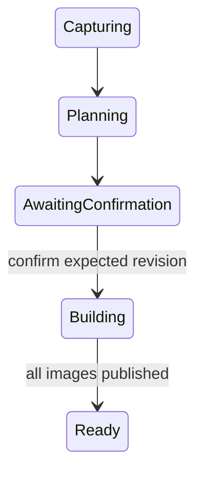

# Archive API lifecycle and boundaries

The public Rust DTOs generate JSON Schema, OpenAPI components and TypeScript.
The standalone client exposes typed calls without depending on core/server. The
operation map initially reserves archive routes; each route enters OpenAPI paths
and capabilities only when its server implementation lands.

Collections belong to one authenticated account. A collection owner must still
have current read authority for every captured root/version. Administrators can
manage archives subject to explicit source authorization. A browser can manage
archive records and download ISO images, but cannot upload, delete or replace
source snapshot files. Restoring writes to an explicit local destination outside
ScT. Historical source names and disc maps must not leak after source grant loss.

`POST /archives` creates a collection with a label, explicit physical media byte
capacity and request ID. `PATCH /archives/{collection}` requires its expected
revision. `POST /archives/{collection}/sets` captures 1–1024 explicit committed
root/version/path selections, expected collection revision, request ID and media
capacity. Paths are retained as selected; overlapping paths, even across roots,
are rejected rather than silently merged. A tree version is immutable; a list of
independent file versions does not imply a cross-root application checkpoint.

Capture and planning are asynchronous, disk-backed and bounded per worker lease.
A collection permits one active append. Poll its set resource for bounded progress;
list endpoints accept the standard `ListRequest` limit/cursor and return a next
cursor. The allowed job transitions are:

Any active state can become Failed, Cancelled, Expired or Revoked. These and Ready
are terminal for that set. Cancellation requests use expected set revision and a
request ID; workers stop at bounded checkpoints, release temporary pins/reservations
and remove incomplete artifacts. Revocation stops work before more source data is
read or exposed. Start a new authorized capture after a terminal failure; a frozen
plan never silently recaptures newer versions. Retrying an identical request ID
returns its original result; changing its canonical body is an idempotency conflict.
Revisions protect concurrent edits, while idempotency protects ambiguous retries.

The plan summary reports new/reused payload, required old/new disc counts, repeated
index/software bytes, filesystem reserve, total ISO budget and fixed bundle hash.
Disc pages provide the complete required set rather than an unbounded inline list.
Confirmation freezes the layout, source identity, disc IDs/numbers and bundle hash.
Metadata plus software must fit on EVERY disc; otherwise return
`archive_metadata_too_large`, never move the only index onto the final disc.
Cancelled plans may leave numbering gaps; published identities are never reused.
A catalog recovered without proof of its latest high-water mark must require
reconciliation before another append.

Readiness means an immutable set was published. Each ISO artifact independently
tracks Building/Available/Expired/Failed, exact size/hash and download observations.
Cache expiry is not destruction of historical archive state, and Ready never turns
into Expired when its download cache is cleaned. An unavailable ISO returns
`archive_artifact_unavailable`; byte-identical reconstruction is not promised when
its required source or build inputs are gone.

Physical copies have labels, self-reported burn dates, current health and immutable
verification reports. Registering a burn or downloading an ISO does not verify
media. Only a full read-back report matching the disc identity, index, software
bundle and exact payload inventory can set ReadBackVerified. A manual copy update
cannot set that health. Later reports or Damaged/Missing observations can change
current health without deleting earlier completion evidence. Reports are
attributed client observations, not remote proof of physical burning.

Recovery results distinguish CompleteSnapshot, CompleteFilesOnly and Unavailable.
Missing objects retain root-scoped digests, affected paths and candidate disc IDs;
large reports are paged. Degraded recovery writes only complete files, never claims
application consistency, and never silently substitutes old file versions.

`archive_busy` and `archive_reconciliation_required` are conflicts (409), expired
plans/artifacts are gone (410), and an unrepresentable per-disc index is 422.
Ordinary authority/revision/quota/integrity errors retain their shared contracts.

## Enforced authority

Collection/history/index pages and work batches recheck current credentials and
root grants. A disc read authorizes every source in that disc's original complete
index, even when a later set no longer references some of them. Pages containing
sources the caller cannot read are denied; ownership does not reveal a partially
redacted index. Cursor tokens are account- and query-scoped, with set revision
binding for mutable previews. Administrators can inspect other accounts explicitly;
ordinary account listings return only their own collections.

Workers call the captured-credential authority check before each bounded batch.
Lost grants, disabled accounts and revoked/expired credentials move active work to
Revoked. An in-flight authorized batch or bytes already downloaded cannot be
retracted; later reads/downloads require fresh checks. Pin/cache cleanup follows
worker fencing. Archive requests and revocation outcomes enter the management audit.

Cookie sessions are rejected on upload/tree-draft/namespace/purge mutation routes
before parsing content bodies. Core Write/Delete/Purge authorization also requires
a program token, including for administrator principals. This covers alternate
entry points such as move previews or resuming purge jobs; policy-only management
continues with ManagePolicy. The browser can create archive captures because they
read committed sources and manage export state, not mutate source snapshots.
